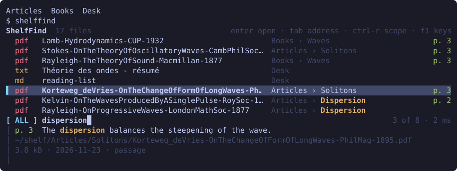

<!-- Copyright 2026 Eudaemonic Enterprises Inc. -->

# ShelfFind

Find a document by its name, a few remembered letters, its folder, or a passage, without leaving the terminal. ShelfFind keeps a private index of the folders you choose, searches names and full text as you type, and opens the chosen document at the page of the passage. Search works while the index is building.



## Install and search

On Linux, use Python 3.11 or newer with SQLite FTS5 support. From the repository run `uv tool install .` or `pipx install .`. ShelfFind has no Python package dependencies. Register the folders you want on this computer.

```sh
shelffind roots add ~/Documents ~/Downloads
shelffind index
shelffind
```

The first pass lists every regular file. The second reads supported documents, copying several files at once while one is read (`index.workers`, four by default), in an order of this machine's own, or the smallest first (`index --order smallest`, or `index.order`), which over a slow line brings the most text in the least time, or the largest first, so that two machines read from the two ends of a shelf. To start with filenames, use `shelffind index --names-only`. Run `shelffind index` again after adding or moving files. `shelffind roots remove FOLDER` forgets a folder and what was indexed from it, and leaves the documents where they are. Press Ctrl-C to interrupt a build. A later run continues with pending and changed files. A disconnected registered mount retains its last complete inventory. Folder symlinks and overlapping roots are excluded from traversal.

## Documents, copies and moved files

The text that ShelfFind reads belongs to a document, not to an address. A file that you rename or move keeps its text, and a document kept in two places is read once and shown on one row, which names its other copies.

A document is known by the checksums of its whole content, MD5 and SHA-256, and by nothing else. Names, sizes and dates prove nothing: two files with the same name, the same size and the same date in two folders may hold different texts, and each is a document of its own until a checksum shows otherwise. Where a file belongs follows from two kinds of facts alone, whatever the order in which they came to be known. The first is what was measured of the file: its checksums, which a reading of the whole file gives, and of which the storage of a folder gives the MD5 without any reading when the settings name the rclone twin of the folder. A measured file belongs to the document known by its checksums. The second is the word of a source, a library for instance, which says that a file is a work it knows by its checksum: a file that was never measured is placed by that word, with the files that hold those checksums or are said to. A measure outranks a word. A statement that a measure refutes is dropped, whichever file was measured, and what a source says is kept with the very file it was said of, so that it follows that file and no other. It outlives that file only as far as a measure proved it: a statement that gives a checksum measured of the document stays with the document, as said of those bytes, and anything else that was said of a file goes with it, the source being asked again wherever the file reappears.

Text belongs to bytes. To read a document, ShelfFind copies its file to this machine in one pass, computes the two checksums during that pass, and reads the copy: the pages it keeps are those of the very bytes the checksums describe. Only a file measured to hold these bytes shows them, or completes them when scanned pages are recognised later, and a file that a source merely says to be the document shows them for as long as no measure says otherwise. A copy that contradicts the checksum given by the storage is made a second time, since a file that comes through a network may arrive damaged. The copy is made in a folder that each run makes for itself inside the data folder of ShelfFind, which needs room for one document at a time, and is removed when the document is read; it is named after the file, with every character that a shell would take for an order put down, so that a file name cannot give one to a converter. The copies of the next documents that are held ahead (`index.workers`) are at most a quarter of the room that is free. The index keeps the name of that folder for as long as it exists, and ShelfFind removes nothing that its index does not name: what a run that was cut short left behind is removed by the next one, and a folder of yours is never taken for one of its own. When there is no room, or the copy cannot be written, the reading stops and says so, and no document is marked as failed. No folder of documents can be registered inside the data folder, nor moved there through the settings. A DjVu document kept in several files is not read for that reason, and `djvmcvt -b` makes one file of it.

An inventory alone (`shelffind index --names-only`, and the refresh that the panel starts by itself) opens no file. It compares the files only as far as a storage tells their checksums, and leaves the rest to the next `shelffind index`, which also proves what the sources said; until two copies have been compared, they appear on two rows. A storage is believed for a file that it holds with the same size and the same date as the folder, before and after its checksum is asked, and says nothing of a file while it lags behind the folder.

Six limits are worth knowing. A storage that holds other bytes under the size and the second of a file, as after an edit made within one second that it has not received, or that changes a file and changes it back while it is asked, is believed until the file is read. The word of a source about a file that was never measured is believed until the next `shelffind index` proves or refutes it, by the checksum that the storage of the folder gives or by one reading of the file, which is made where there is no storage, where the storage does not hold the file, and where it gives a checksum of another kind than the source; an inventory alone proves nothing. A statement that gives no checksum cannot be proved: it names a work, and never keeps ShelfFind from reading the file. A statement that gives two checksums is proved by the one that is measured, and the other is then taken on the word of the source until the file is read in full; when two statements kept with one document give two different checksums of one kind, one of them is false, and `shelffind index` reads a file of the document in full to tell which. Two files made on purpose to share one MD5 are told apart by their SHA-256 once both are read in full, and not before: ShelfFind is not built to withstand files made to collide. A file replaced at its address by other bytes of the same size and the same date, to the nanosecond, is taken for the file that was there until it is read again; a file written in place while it is being read is noticed by the time of its last change, where the file system keeps one, unless the clock of the machine is set back meanwhile. And a folder moved as a whole, its address changed in the settings, keeps its documents: a file found at the same place inside it with the same size and date is taken for the file that was there.

A document whose last file has gone keeps its text for a month, with what the sources said of its bytes, for the day the file is found again, and is forgotten at once with its folder when you run `shelffind roots remove`.

## The search panel

`shelffind` opens a band of lines under the prompt, on the ordinary screen: what the terminal showed before stays above it, and the band disappears when you leave. Each result carries its format, its name with the letters of the query lit, its folders, and the page of the passage; under the prompt come the passage in its context, the address of the document and a line of facts.

| Key | Action |
|---|---|
| Enter | Open the document, at the page of the passage where the viewer accepts one |
| Tab | Leave with the address of the document: printed, or put on the command line by the key binding |
| Ctrl-R | Search everything, names only, or passages only |
| Ctrl-O | List the passages of the chosen document in the order of its pages; again, read the page in the panel |
| Ctrl-X | List what can be done with the chosen result |
| Up, Down, PgUp, PgDn | Move in the list; the best match is next to the prompt |
| Alt-1 to Alt-9 | Open one of the nine best results at once; each row shows its rank |
| Ctrl-P, Ctrl-N | Earlier and later searches |
| F2, F3, Ctrl-Y | Open with another application, show in the file manager, copy the address |
| F4, F5, F6 | One folder, one format, one source, or all |
| F7 | Exact search on or off: the words as typed, with no completion, no spelling help and no letters in order |
| F1, Esc | The keys, leave |

The query is edited as a line: the arrows, Home and End move the cursor, Ctrl-W removes a word, Ctrl-U what precedes the cursor, and pasted text is taken as typed. Fuzzy matching is built in. It handles prefixes, abbreviations, omitted letters, and adjacent transpositions. Exact name and path matches appear first, documents before the programs and pictures that some folders hold, and a third of the list is kept for passages when names would fill it alone. The words of a query may be shared between the two: `whitham dispersion` finds the book whose name, folder, title or author holds one word and whose text holds the other, listed after the documents found by their names and before those found by their text alone, at the page that holds the word asked of the text. A word or a phrase between double quotes is always taken as written. F7 turns the fuzzy matching off and on for the whole query, the prompt then showing the word `exact`, and `exact = true` under `[search]` in the settings makes exact search what the panel opens on.

Filters can be typed among the words of a query: `ext:djvu` keeps one format, `in:Books` a registered folder by its name or any part of a path, `src:catalogue` one source, and `-draft` drops the files whose name or path contains the word. So `tide ext:pdf in:charts -draft` reads as it is written. While a page is read in the panel, the arrows scroll it, PgUp and PgDn turn the pages, and Enter opens the viewer at that page.

A key at the prompt opens the panel from bash. Add `eval "$(shelffind init bash)"` to `~/.bashrc`; Ctrl-T then opens the panel, Enter opens the chosen document and Tab puts its quoted address on the command line. `shelffind init bash --key alt-f` chooses another key, and `shelffind completion bash` prints completion of the commands. In a script, `shelffind pick` prints the address of the chosen document and exits with 1 when nothing was chosen.

## Lists and JSON

```sh
shelffind search --list orchadr
shelffind search --json --format pdf '"brass compass"'
shelffind search --root Documents --list garden
shelffind search --where text --list '"brass compass"'
shelffind status --errors
shelffind index --limit 100
shelffind index --retry
shelffind index --ocr --lang eng+fra
```

With `--list` or `--json`, or when the output is not a terminal, no panel opens. Passage results include a snippet and the file page when available. Use `--exact` for whole words without spelling expansion. The filters of the panel work here too; quote a query that contains `-word`, as in `shelffind search --list 'tide -draft'`. At a terminal `search --list` colours its results and makes each address a link, `status` prints one row per folder with a bar for the text at hand, and `index` follows the documents on a single line. Piped output is plain text. `--json` adds machine-readable fields. Names and passages are untrusted text: control characters are removed from what a terminal shows and escaped in JSON. `shelffind cheatsheet` prints a one-screen reference, and the end of `shelffind --help` lists the exit codes and the keys of the JSON for programs that call ShelfFind.

## Settings

Everything that may differ between two people is a setting. `shelffind config show` prints every setting with its value and where the value comes from, `shelffind config path` names the file, and `shelffind config check` reports its faults. The file is `~/.config/shelffind/config.toml`, read after the files it names in `include`, and never written by ShelfFind; environment variables such as `SHELFFIND_PANEL_HEIGHT` come next and win.

```toml
include = ["~/dotfiles/shelffind.toml"]     # optional: a file kept elsewhere, ranked below this one

[panel]
height  = 40            # lines at most, or a share of the window such as "50%"
prompt  = "bottom"      # or "top"
preview = 4             # lines under the prompt; 0 hides them
theme   = "terminal"    # the colours of your terminal; "plain"; or the name of a table below

[keys]
scope = "ctrl-r"        # one or several keys for each action; F1 in the panel lists them

[open]
pdf = ["zathura", "-P", "{page}", "{path}"]     # a viewer of your choice; {phrase} is also known

[roots.Books]
path = "~/Documents/Books"                      # a folder named here is registered by `shelffind index`

[index]
workers = 4                                     # files copied at once while a document is read, 1 to 16
order   = "random"                              # or "smallest" first, or "largest" first
ocr     = "eng+fra+rus"                         # the languages of Tesseract for scanned pages (--lang wins)

[convert.doc]
command = ["antiword", "{path}"]                # a format read by a program that prints its text

[machines]
0123456789abcdef = "home"                       # a name for a machine by its label, which `shelffind machine` prints

[theme.dusk]
match    = "bold #e0af68"
selected = "on #2f334d"
```

By default the panel uses the sixteen colours of the terminal, so it agrees with the scheme chosen there; `NO_COLOR` is honoured. `shelffind doctor` checks the installation line by line (the readers of each format, the viewers, the folders, the sources, the terminal) and says how to repair what is missing. It changes nothing.

## Reading and opening files

| Format | Local programs used |
|---|---|
| PDF | `pdftotext` from Poppler |
| DjVu | `djvutxt` and `djvused` from DjVuLibre |
| PostScript and gzipped PostScript | Ghostscript and Poppler |
| EPUB | Python's standard library, following the EPUB reading order |
| HTML, Word (`docx`), OpenDocument (`odt`) and FB2 | Python's standard library: HTML in the encoding it names and without its scripts, the others through their paragraphs, FB2 under the titles of its sections |
| UTF-8 plain text, Markdown, reStructuredText, TeX, Typst and BibTeX | Python's standard library |
| Any other format | A program of your choice, named under `[convert.FORMAT]`, which prints the text of the document given as `{path}` |
| OCR for images inside PDF, DjVu and PostScript documents | Tesseract with the selected languages, plus `pdftoppm` or `ddjvu` |

A document without pages (an EPUB, a Word or HTML file) is cut into passages of about six thousand characters made of whole paragraphs, each named after its section. Files with other extensions are searchable by name and folder, unless the settings name a converter for them; a file listed before its format was read waits for its text from the next inventory on. Pages without embedded alphanumeric text are marked for OCR. The optional OCR pass recognises several pages of a document at once (`index.workers`, Tesseract held to one thread each) and saves each completed page in the order of the pages, so that an interruption keeps all those before it. Failed reads appear under `status --errors`. Enable `--retry` after installing a missing program or repairing a file. `index --file PATH` limits content extraction to one file and can be repeated.

```sh
shelffind open ~/Documents/atlas.pdf --page 12
shelffind apps ~/Documents/atlas.pdf
shelffind open --with org.gnome.Evince.desktop ~/Documents/atlas.pdf
shelffind reveal ~/Documents/atlas.pdf
```

Documents open through the desktop (GIO and `gtk-launch`). A page is passed to the viewers known to accept one: Evince, Papers, Atril, Xreader, Okular, Zathura, Sioyek, DjView and the web browsers; others open at the first page unless a command is given under `[open]`. `reveal` asks the file manager of the desktop, whichever it is. `apps` lists the applications registered for that kind of file, each with its identifier, which `open --with` takes, and the name you know it by; F2 in the panel offers the same list by those names, the application that opens the file by default first.

## Sources

A source is a program that answers for a collection ShelfFind does not index itself: a reference manager, a library of full texts, a catalogue. Its answers appear in the same list as the files of the folders. With no source registered, every search uses the folders alone. ShelfFind runs only the programs you register, and sends them the words you type.

```sh
shelffind sources add catalogue /absolute/path/to/catalogue-provider
shelffind sources check catalogue tide tables
shelffind search --source catalogue --json orchard
shelffind open --source catalogue RECORD-ID
shelffind sources remove catalogue
```

A source may also be declared in the settings, with arguments: `[sources.catalogue]` and `command = ["catalogue-provider", "--fast"]`. `shelffind sources check NAME WORDS` asks a source every question it says it answers and prints one line for each, which is the quickest way to see what a new source does.

A source can do more than answer searches. When it knows files of your folders, ShelfFind asks it which ones after each inventory, and a document that both hold then appears once: on the row of your file, under its true title and authors, with the warnings and the notes of the source, and with the passage of whichever found one. The file is found by the words of that title as well as by its name. When the source holds the text of a file, ShelfFind does not read the file itself, and reads it after all once the source is removed; `text = "ignore"` under `[sources.NAME]` keeps the reading at home, and `identify = false` stops the question. The actions a source offers (copy a citation key, show its notes) join the list of Ctrl-X, and the passages of a document are listed from the source when ShelfFind has not read it. A source that needs the network is asked only when you name it, with `src:NAME` or `--source NAME`, never at each letter typed.

The exchange between ShelfFind and a source is small and stable: one JSON question in, one JSON answer out. It is described in [docs/sources.md](docs/sources.md), with a helper of one file, `shelffind/provider.py`, that turns a few Python functions into a source. `contrib/zotero.py` is a complete example: a source for a local Zotero library, which reads its database without ever writing to it, finds works by title, author, year and journal, recognises the files of your folders that Zotero holds, and offers to show a work in Zotero or to copy its citation key. Register it with `shelffind sources add zotero /path/to/contrib/zotero.py`.

The private index, the registered sources and the searches made are under `$XDG_DATA_HOME/shelffind`, normally `~/.local/share/shelffind`. Use `--data-dir DIRECTORY` before the command for a separate collection, which then reads only `DIRECTORY/config.toml`.

## Several machines

When you work on several machines, ShelfFind can share between them the journal of what you searched and opened, so that a search made on one is offered on the others, and the documents opened lately, wherever that was, come first in an empty panel and rise among the results. It can also share the text that each machine reads, so that a document is read once for all of them. Nothing is shared unless you ask for it:

```toml
[share]
history = true
texts   = true
folder  = "~/Sync/ShelfFind"        # a folder that some tool keeps in step between the machines
# remote = "cloud:ShelfFind"        # or a remote of rclone
```

Give each machine a name once with `shelffind machine --name home`, or name them all in one shared settings file under `[machines]`, by the label that `shelffind machine` prints, which wins over the name a machine gives itself, since several machines may call themselves by one hostname. `shelffind sync` exchanges at once, and the panel starts an exchange by itself after it closes when the last one is more than ten minutes old. Each machine writes only its own files in the shared place, a journal for each month and a list of them with their checksums, and takes a journal of another machine only when its checksum agrees. An address travels written from the home folder (`~/Books/atlas.pdf`), so it means the same on a machine where your home folder has another name. What the journal holds is the words of each search, the address and the name of each document opened, and the time; a search that begins with a blank is not recorded, and `history.record = false` records nothing at all.

With `texts = true`, each machine keeps its own index on its own disk, and the text it reads travels to the others in parcels of at most 16 MB, which unpack to at most 256 MB and are never changed once written; a document too large for a parcel of its own, or of more than 100 000 pages, is not shared, and each machine reads it for itself. Each data folder writes its parcels and the list of them, with their checksums, under a name of its own, kept in its file `writer.json`, so that two data folders, even on one machine, never write the same file; a machine copied whole, with its system and its disk, keeps that name, and its copy must be given another by deleting `writer.json` in its data folder; while that file cannot be read or written, the data folder gives nothing. A parcel is written under a passing name and then given its own, so that no one meets it half written, and its number is never given twice: the greatest number seen is kept both in the list and in the bookkeeping, so that only the loss of both together, while a parcel of the data folder is still on its way, could let a number come back. Another machine takes a parcel only when its size, its checksum and the number of its documents are those of the list: a parcel cut or changed on the way is taken another time, and one written by a newer ShelfFind waits for this one to be updated, as does a shared place that a newer ShelfFind has marked as its own.

What travels is this. A list names the parcels of its data folder with their sizes, checksums and numbers of documents, and the last number it gave. A parcel holds, for each document, the MD5 and the SHA-256 of the bytes its pages were read from, with their size and format, and the whole text of its pages, with their numbers or the names of the chapters of an EPUB, and which pages still wait for their recognition; it names no file and no folder, though a text may of course name anything, and the chapters of an EPUB are sometimes named after the files inside it. Anyone who may write in the shared place may put texts there: share it only with your own machines. To withdraw the texts, set `texts = false` on every machine first, then delete the folder `texts` of the shared place: a machine that still shares writes its texts there again, and the pages that the others took stay in their indexes.

The pages go to a document only during a run of `shelffind index`, an inventory included, once the files are listed and the sources asked: to the document that a measure of this machine knows by the same checksums, when it has a file, waits for its text, and is not left to a source that holds its text. A document without pages takes the reading whole. A document with pages takes, page by page, the pages it still has to recognise from a reading of the same pages, and nothing it recognised is ever replaced, so the recognised pages of several machines add up, whatever the order in which they come; where two machines recognised one page differently, the recognition that came first stands, and a reading with other pages than ours is left aside. A run takes what the others read before it compares the files, measuring the files of the sizes offered, so that a document read elsewhere is not read here, and reads in an order of this data folder's own. A file copied for its reading whose very bytes another machine read is not read: its document takes those pages at the end of the pass, once the sources have been asked about the checksums just measured, and provided the file has not changed since its copy. Whatever the way, a document takes pages only when each of its files in a folder at hand is still a file, not a link, with the size and the date that the inventory saw, nothing of it changed since the run began, which the time of its last change tells, and it is still the very file that the run listed, whatever was done to its folder; a document refused so is read on this machine, and the file that failed is measured anew, whatever stands at its address later and whatever its size and date, while a file that the run did not list and that is no longer there holds nothing back. Between two runs, as for every file (see above), one replaced by other bytes of the same size and the same date, to the nanosecond, is taken for the file that was there until it is read again. The pages offered are taken in rounds, each document taking first the reading that leaves the fewest pages to recognise, and the rounds go on, with the sources asked again between them, while they teach something, up to a thousand; what is left then waits for the next run. The run exchanges texts after a document read when the last exchange ended more than two minutes ago, or ten times as long ago as it took when that is longer, since an exchange with a distant place may take minutes and a reading must keep most of the time; it gives what it read at the end. Nothing reserves a document for one machine: two machines reading at once begin with different documents, and a document is read on both when each reaches it before the parcel of the other has come, which depends on the time a reading takes and on the time the shared place takes to carry a parcel; two machines that start together on an empty shared place may thus read the same documents during their first minutes. A page recognised later on one machine reaches the others in the same way, and what a machine received it never sends back. Only what this version read itself from the bytes it measured, or took whole from another machine, is given: pages that version 0.2 or 0.3 read stay on their machine, whenever they were read, since nothing proves which bytes they were read from, and such a document travels once it is read again. Plain text and EPUB have no page to recognise, and a parcel that says otherwise of one is not taken. `shelffind sync` carries parcels both ways and places no page; it ends with exit code 1 when the shared place fails, a list or a card that cannot be fetched included, and a parcel that arrived damaged is said and taken again at a later exchange; through rclone, only its exit codes for a folder or a file that is not there (3 and 4) count as an absence, and a list of files that cannot be read stops the exchange. A machine whose journals are not shared writes no card in the shared place, its texts alone being named by the name of its data folder; the journals are those of the machine, so two data folders of one machine that both share them replace each other's, and they are best shared from one. The exchange concerns the whole index, whatever folders or files a run is limited to, and pages taken do not count among the documents read.

A file measured only by the storage of its folder takes the text that another machine read of the bytes that storage names: a storage that holds other bytes under the size and the second of the file (see above) is then believed until the file changes, and changing its date (`touch`) makes ShelfFind measure it anew. What a data folder knows of the parcels is kept in `exchange.sqlite3`, for one shared place, and made anew for another; it may be deleted while no run and no exchange is under way, and the lists are then read again, with nothing read twice. Each exchange begins with the list of the data folder itself, checked against its parcels: it names again those that a lost or spoilt list forgot, names a parcel whose list could not be written once the parcel is found whole, gives again, under new numbers, the documents of a parcel that was lost, keeps naming a parcel of its own written by a newer version, and removes what a writing of its own cut short left under a passing name; a list written by a newer version is left to it, whatever it holds, and a list that would grow beyond what a reader takes is not written. A parcel put is read back once, at the next exchange, and from then on known by the size and the date that the shared place gives it: when they change, it is read again, twice if need be. A parcel of its own that the shared place does not hold, or holds with other bytes than those put, stays named, as it may yet come back or be put right, while its documents are given again under a new number; one that is there is read again at the exchanges numbered by the powers of two, and always before it would be named no more, which happens once that has lasted seven days and fifty exchanges. A list that describes a parcel of its own otherwise than the bookkeeping, and that describes the bytes there, is believed. Nothing in the shared place is deleted, but what a writing cut short left under a passing name. Through rclone a list is replaced by a rename, which on some storages removes the former list first: a writing cut short at that very moment leaves the list missing until the next exchange of its data folder writes it again, and the others meanwhile keep what they took. What another machine withdraws, a parcel that its list no longer names or everything of a machine whose list and parcels are gone, is forgotten, and a reading of this machine held back because of it is given in its place. A data folder gives at most 999 999 parcels, and its list holds at most 16 MB, some ninety thousand parcels: beyond that it gives nothing more, and says so.

## Keeping the folders in order

```sh
shelffind report copies             # the documents kept in several places, the largest first
shelffind report unlinked           # the files of readable formats that no source knows
shelffind report names              # the files whose name does not show the work a source says they are
```

Each list can be limited to one folder with `--root NAME` and printed as JSON with `--json`. The list of files is refreshed by itself beside the panel when it is more than an hour old (`index.refresh`, in minutes; 0 leaves it to `shelffind index`), so a file you filed elsewhere a moment ago is found at its new place with its text.

## Coming from version 0.2

The index of version 0.3 has a new form. The first time you open the panel or run `shelffind index`, the earlier index is converted by copy: the new index is written beside it, and the earlier one is kept, marked so that an earlier ShelfFind no longer uses it. The folders, the files, the pages that were read and the searches are carried over, and the lists of names and of words are made anew from them. Every file comes over as a document of its own, with the very pages that were read from it, and no text has to be extracted again. Those pages are tied to their file by its address, its size and its date, and to nothing else, until the file is read in full once: the first `shelffind index` after the conversion does that for each file that was read, which costs one reading of the file and no extraction, and from then on copies share one row and a moved file keeps its text. When two files of the same content had both been read, their readings are joined: a reading of the same pages is completed by the pages that the other alone had recognised, the text of the file read in full first standing where both had recognised a page, in two languages for instance, and of two readings of different pages the one that recognised more pages is kept; what is not kept remains in the earlier index for as long as you keep it. These pages stay on their machine: nothing proves which bytes version 0.2 read them from, so they are not given to other machines (see Several machines), any more than what version 0.3 read; a document travels once version 0.4 reads it again. Run it once before you rename or touch those files; a file that is moved or changed before then is read anew. The conversion wants the earlier index for itself: it waits for a reading of documents by an earlier ShelfFind to end, and refuses for as long as another program, such as a search panel left open in a terminal, still has the earlier index open. It also refuses an earlier index that is not kept in the write-ahead mode in which version 0.2 creates it, or that does not declare, word for word, what versions 0.1 and 0.2 declared when they created it, tables, columns, indexes and triggers, nothing more and nothing less, since what an index holds beyond that would be lost; and a file under the name of the earlier index that is not an index of ShelfFind is never hidden behind a new one. `shelffind status` answers from the earlier index without converting it, and a command run by a script on a large earlier index stops with exit code 75 and asks for `shelffind upgrade`, which converts at once. When the new index has served you well, `shelffind upgrade --discard-old` deletes the earlier one, provided it is still, row for row in every table, what the new index was made from, holds nothing that a conversion does not carry over, and stands beside a new index that this version can use, of its format and laid out as it lays its index out; its searches are put in the journal once more before. An index made by a trial of version 0.3 is refused by every command, with the advice to move it away.

## Tests

Run `PYTHONPATH=src python3 -m unittest discover -s tests -v`. Format integration tests use the available document tools and synthetic files. The OCR test checks recovery from an interruption between pages. The panel is run in a pseudo-terminal whose output is read by a strict small terminal that refuses any sequence outside an allowed list, and inside tmux with a real shell when tmux is installed. The recognition of documents and the conversion of an earlier index are tested case by case, including the cases where a likeness could mislead, and on random histories of a small shelf whose every file is known to the test: after each step no file may show a text that is not its own, every checksum kept must be that of the bytes, a run must have done what it reports, the search index must hold what the pages hold, and the documents must be those that the facts name, whatever the order of the events. In these histories another machine gives, now and then, the pages of a work it read. Two machines on one computer, each with its own home folder, index and identity, share a folder or an rclone remote, and a parcel is cut, changed, removed, taken in part, or written by a newer version. `SHELFFIND_HISTORIES=5000` runs that many histories instead of forty. The sources are tested against small programs that speak both versions of the exchange.

Copyright 2026 Eudaemonic Enterprises Inc. Released under the Apache License, Version 2.0.
